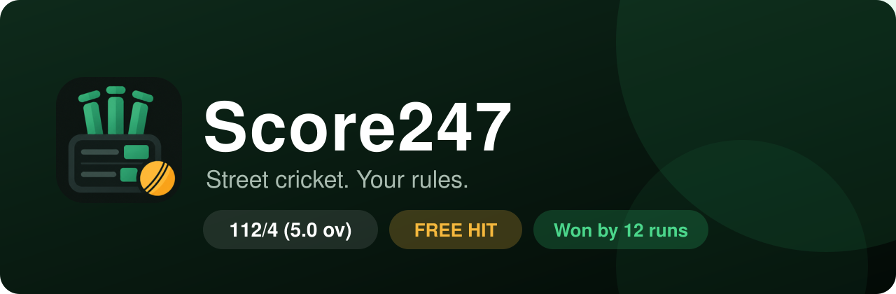
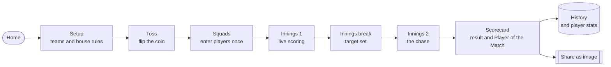
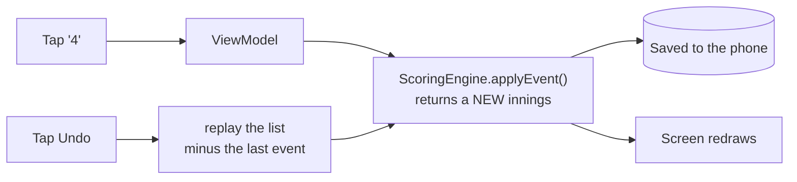
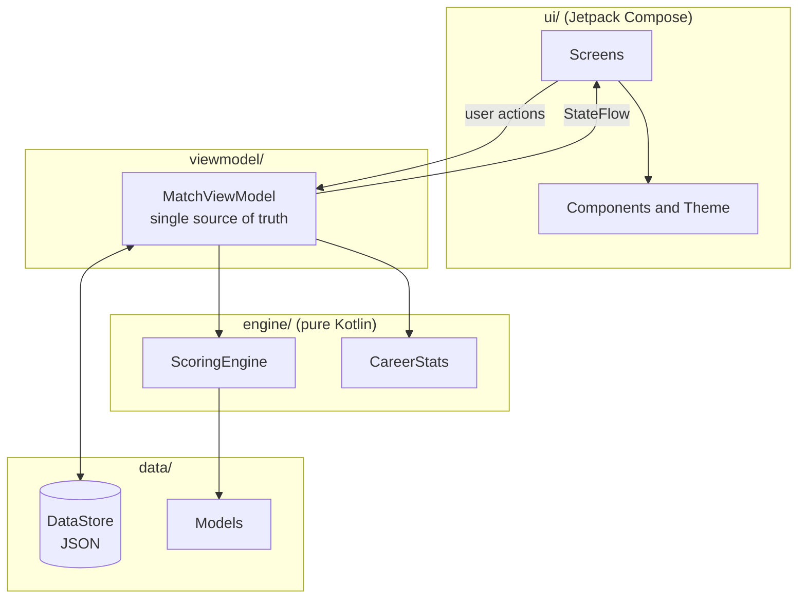

<div align="center">



<br/>

[](#-getting-started)
[](https://kotlinlang.org)
[](https://developer.android.com/jetpack/compose)
[](LICENSE)
[](CONTRIBUTING.md)
[](PRIVACY.md)

### The cricket scorer built for gully, street and backyard matches.
**Your wide rule. Your no-ball rule. Your last-man-stands rule.** Score it ball by ball, undo any mistake exactly, and share a scorecard people actually want to look at.

[**Get started**](#-getting-started) &nbsp;|&nbsp; [**Features**](#-features) &nbsp;|&nbsp; [**How it works**](#-how-it-works) &nbsp;|&nbsp; [**Learn the code**](EXPLAIN.md) &nbsp;|&nbsp; [**Contribute**](CONTRIBUTING.md)

</div>

---

## Why Score247?

Most scoring apps assume a stadium. Street cricket has its own rules: *a wide gives a run, a
wide does not count as a ball, the last batter keeps going alone, a no-ball means a free hit.*
Every group plays slightly differently, and the scorer ends up arguing with the app.

Score247 lets you **switch each house rule on or off before the match**, then does the maths
for you, correctly, every ball.

## ✨ Features

<table>
<tr>
<td width="50%" valign="top">

### 🏏 Scoring that keeps up
- Big, thumb-friendly run pad: 0 to 6, wicket, wide, no ball
- Every dismissal, incl. run-outs of either batter
- Free hit after a no-ball
- Live run rate, required rate and chase progress
- Haptic ticks and a screen that never falls asleep

</td>
<td width="50%" valign="top">

### ↩️ Undo that is always exact
- Fix any mistake, even the ball that ended the match
- Every stat is recomputed, not patched, so nothing drifts
- Bowler changes and wicket replacements are replayed correctly

</td>
</tr>
<tr>
<td width="50%" valign="top">

### 📊 History and player stats
- Every finished match is saved on your phone
- Career leaderboards: runs, strike rate, average, wickets, economy, best figures
- Reopen, share or delete any past match
- Setup remembers your last teams and rules

</td>
<td width="50%" valign="top">

### 📸 Shareable scorecards
- A story-sized picture (1080 x 1920) for Instagram, WhatsApp and more
- A **QR code** on the picture opens this repository, so anyone who sees it can get the app
- Plain-text version too, with the link in the caption

</td>
</tr>
<tr>
<td width="50%" valign="top">

### 🎨 Designed, not defaulted
- Scoreboard-inspired look with light and dark themes
- All colour pairs meet WCAG AA contrast (4.5:1 or better)
- Screen-reader labels and 48 dp touch targets

</td>
<td width="50%" valign="top">

### 🔒 Private by design
- No accounts, no ads, no analytics, no network use
- Your matches never leave your phone unless you share them
- Open source under the MIT licence

</td>
</tr>
</table>

## 🧭 How it works



### The one idea that makes it reliable

An innings is not stored as a pile of running totals. It is stored as **a list of things that
happened**: "4 runs", "wide", "wicket: caught". Every number on screen is worked out by
replaying that list.



That is why **undo can never leave the numbers out of step**: there is no special undo code, only
"replay everything except the last ball". The rules engine is plain Kotlin and is covered by
unit tests, including a randomised test that plays hundreds of random innings and checks every ball.

## 🏗️ Architecture



| Layer | Folder | Job |
|---|---|---|
| UI | `ui/` | Draw the screens; report taps. Knows nothing about cricket rules. |
| State | `viewmodel/` | Holds the one live match, applies actions, saves changes. |
| Rules | `engine/` | All cricket logic and statistics. No Android code, fully unit-tested. |
| Data | `data/` | The models, and saving as JSON with DataStore. |
| Utils | `util/` | Number formatting, share text, share picture, QR. |

## ⚙️ House rules you can toggle

| Rule | What it does |
|---|---|
| Wide adds a run | A wide costs the bowling side one extra run |
| Wide is a legal ball | A wide uses up one of the six balls (street rule) |
| No-ball adds a run | A no-ball costs one extra run |
| Free hit after a no-ball | Only a run-out can dismiss the next batter |
| Last batsman bats alone | The innings continues until the final player is out |

Plus overs (1 to 50) and players per side (2 to 11).

## 🧱 Tech stack

| | |
|---|---|
| Language | Kotlin 2.0 |
| UI | Jetpack Compose, Material 3, Navigation Compose |
| State | `ViewModel`, `StateFlow`, coroutines |
| Saving | Jetpack DataStore + kotlinx.serialization (JSON) |
| Share | Android Canvas picture, ZXing QR, FileProvider |
| Tests | JUnit, including a randomised replay test |
| Min SDK | 26 (Android 8.0), target 35 |

## 🚀 Getting started

```bash
git clone https://github.com/waleedahmedja/Score247.git
cd Score247
```

1. Open the folder in **Android Studio** and let Gradle sync.
2. Press **Run** on an emulator or a phone.
3. Run the rules tests any time with:

```bash
./gradlew test
```

> **Sharing pictures:** one small addition to `AndroidManifest.xml` is needed. See
> [docs/SETUP_SHARING.md](v0.3.0/docs/SETUP_SHARING.md).

<details>
<summary><b>📁 Project structure</b></summary>

```
app/src/main/java/com/waleedahmedja/score247/
├── MainActivity.kt            the front door
├── navigation/AppNavigation   which screen leads to which
├── viewmodel/MatchViewModel   the one live match + history
├── engine/
│   ├── ScoringEngine          every cricket rule
│   └── CareerStats            player totals across matches
├── data/
│   ├── model/Models           matches, innings, balls, rules
│   └── datastore/MatchDataStore   saving as JSON
├── ui/
│   ├── theme/Theme            colours, shapes, fonts
│   ├── components/            buttons, cards, run pad, share buttons
│   └── screens/               Home, Setup, Toss, Players, Scoring,
│                              Innings break, Summary, History, About
└── util/                      formatting, share text and picture, QR
```

</details>

## 📚 Learn from the code

New to Android or Kotlin? **[EXPLAIN.md](EXPLAIN.md)** explains every file in plain
English, traces one ball from tap to saved data, and lists interview questions with answers.
Every source file also starts with a short note on what it does and why.

## 🗺️ Roadmap

- [x] Match history and player statistics
- [x] Shareable scorecard picture with QR code
- [ ] Animated (GIF-style) share clips
- [ ] Wagon wheel and over-by-over run chart
- [ ] Export and import matches as a file
- [ ] Tournament mode (several matches, a table)
- [ ] Tablet and landscape layouts

Have an idea? [Open an issue](https://github.com/waleedahmedja/Score247/issues).

## 🤝 Contributing

Contributions of every size are welcome, from typos to features. Start with
[CONTRIBUTING.md](CONTRIBUTING.md) and the [Code of Conduct](CODE_OF_CONDUCT.md).

## 📄 Legal

[MIT License](LICENSE) &nbsp;|&nbsp; [Privacy Policy](PRIVACY.md) &nbsp;|&nbsp; [Terms of Use](TERMS.md) &nbsp;|&nbsp; [Security](SECURITY.md) &nbsp;

The same documents are available inside the app under **About and legal**.

## 📦 How to download

Download .apk file from [here]([PRIVACY.md](https://github.com/waleedahmedja/Score247/releases/tag/v0.3.0)) &nbsp;

---

<div align="center">

**Built by [waleedahmedja](https://github.com/waleedahmedja)**

If Score247 helped your match, a ⭐ on the repo means a lot.

[](https://star-history.com/#waleedahmedja/Score247&Date)

</div>
